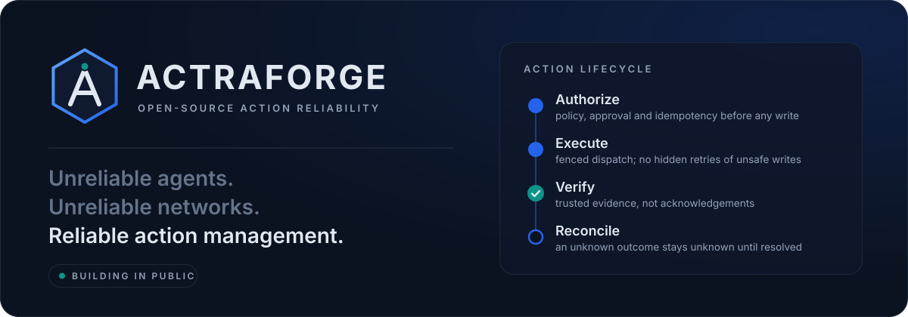

<p align="center">
  
</p>

# Actraforge

Actraforge is an open-source runtime and test lab for external actions taken by software agents.

- **Actraforge Runtime** executes, authorizes, verifies and reconciles external actions
  (device commands, API writes, infrastructure changes) so that lost responses, timeouts,
  duplicate submissions and delayed effects do not turn into duplicate side effects or false
  success reports.
- **Actraforge Lab** evaluates actions, targets and runtimes against reproducible, seeded failures
  with an independent ground truth.

Neither component needs an LLM to be correct.

> **Status: pre-alpha, week 1; v0.1 is planned for week 24.** Nothing here is usable
> yet. No release, benchmark result or production readiness is claimed.

## Core rules (excerpt)

- A timeout is not proof that nothing happened. An unknown outcome stays unknown until trusted
  evidence resolves it.
- No write is retried unless retry safety is established for that target operation.
- An acknowledgement is not success; unknown or disputed evidence is never reported as verified.
- There is no general exactly-once claim. Declared target capabilities are assumptions; tests and
  probes look for counterexamples, they do not prove universal correctness.

See [`docs/contracts/`](docs/contracts/) for the precise semantics as they are written.

## Development

Requires Python ≥ 3.12 and [uv](https://docs.astral.sh/uv/).

```bash
uv sync
uv run ruff check . && uv run ruff format --check .
uv run mypy
uv run pytest
```

Contributor and agent rules: [`AGENTS.md`](AGENTS.md).

## Visual identity

Logo and banner live in [`docs/assets/brand/`](docs/assets/brand/).

| Role | Color |
| --- | --- |
| Background | `#0b1220` |
| Primary | `#2563eb` |
| Verified | `#0d9488` |
| Text | `#e2e8f0` |

## License

Apache License 2.0 — see [`LICENSE`](LICENSE).
